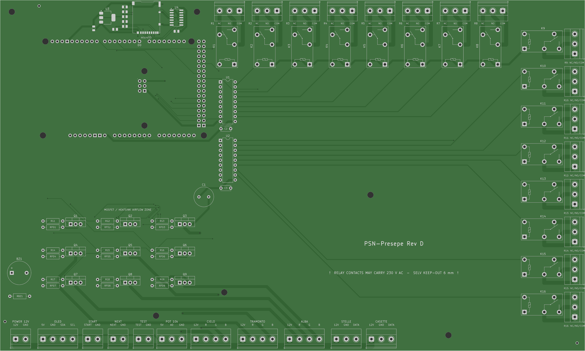
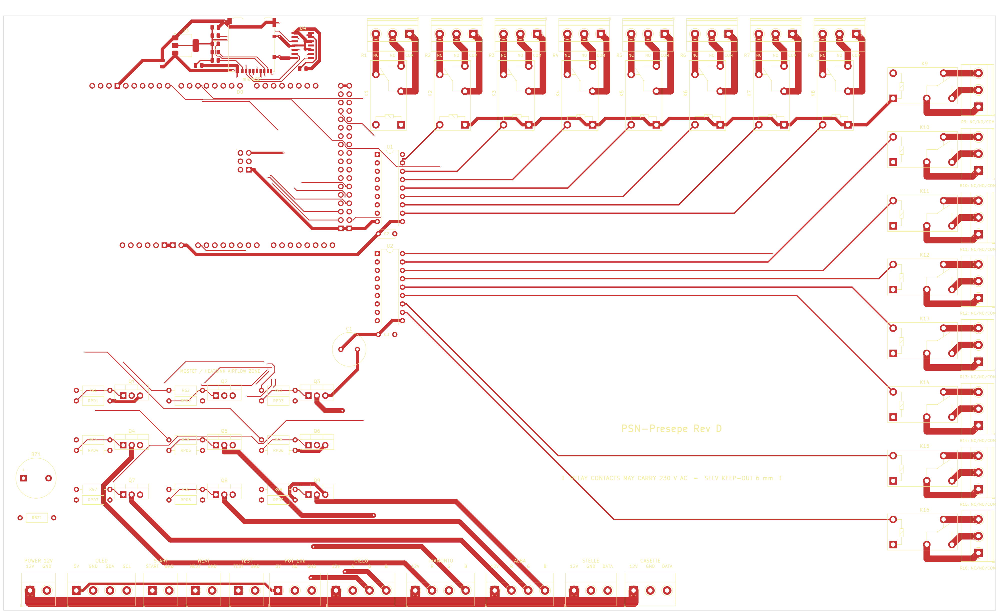
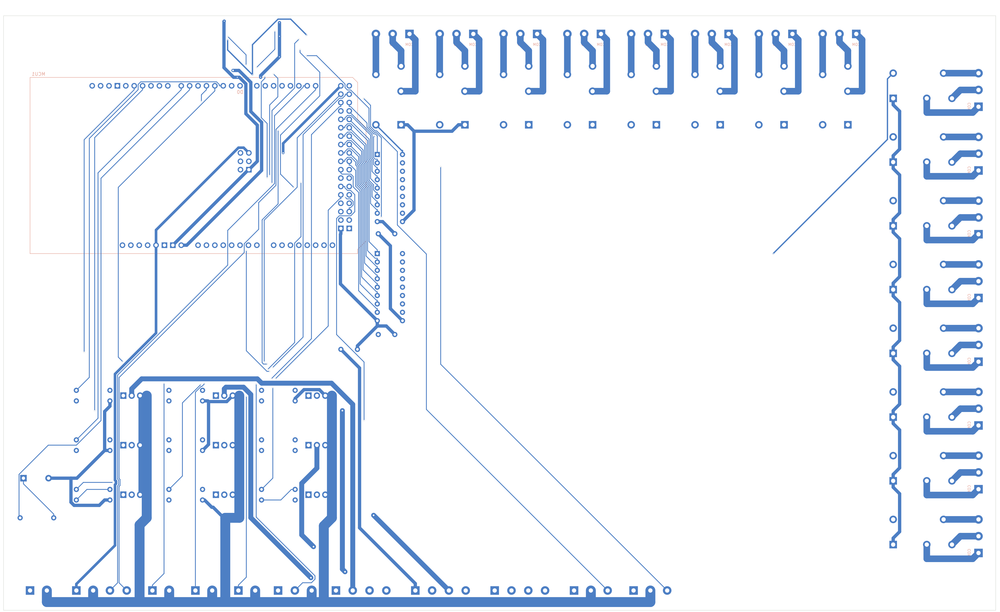

<p align="center"><b>🇬🇧 English</b> &nbsp;·&nbsp; <a href="README.it.md">🇮🇹 Italiano</a></p>

# PSN-Presepe

Arduino Mega 2560 controller for a modular 12 V nativity scene (*presepe*).

It runs a day/night cycle: **GIORNO → TRAMONTO → CREPUSCOLO → NOTTE → ALBA** (day → sunset → dusk → night → dawn). The cycle drives:

- three analog 12 V RGB strips: main sky, sunset side and dawn side;
- two addressable WS2811 chains: twinkling stars and house windows;
- 16 relays for motors, pumps and lamps.

Every scenography parameter can be changed from a `PRESEPE.INI` file on a microSD card, read at power-on.

This repository holds the complete project, for both board revisions:

- the PCB (KiCad), with the scripts that generate and verify it;
- manufacturing files ready for a turnkey assembler;
- the firmware, with its tests;
- wiring documentation for building the controller on a breadboard without the PCB.

> **Status.** The Rev D PCB was ordered from PCBWay (turnkey assembly, see [manufacturing/pcbway-order-2026-10-04](hardware/rev-d/manufacturing/pcbway-order-2026-10-04/README.md)) and the assembled boards have been tested: everything works. **Rev E** (small fixes plus a status LED and test points, same size and connectors, same firmware) is being designed in [`hardware/rev-e`](hardware/rev-e); it has not been ordered yet. See [Rev E](#rev-e-next-revision).

**Two board releases.** Both use the same firmware, the same `PRESEPE.INI` and the same terminals, so the rest of this README applies to either:

| Release | Folder | State | Use it for |
|---|---|---|---|
| **Rev D** | [`hardware/rev-d`](hardware/rev-d) | ordered, assembled and tested: works | the boards already built; reference for reorders as they are |
| **Rev E** | [`hardware/rev-e`](hardware/rev-e) | designed and verified, not ordered yet | the next order: buzzer footprint for the CEM-1203(42), polarised C1, 8 mil spacing, status LED, test points |

To flash the firmware (plain Mega or Mega + WiFi) see [Step by step with the Arduino IDE](#step-by-step-with-the-arduino-ide).



## Contents

1. [Repository layout](#1-repository-layout)
2. [How the controller works](#2-how-the-controller-works)
3. [The Rev D board](#3-the-rev-d-board)
4. [Board connectors (terminal pinout)](#4-board-connectors-terminal-pinout)
5. [Arduino Mega pin map](#5-arduino-mega-pin-map)
6. [Power, currents and fusing](#6-power-currents-and-fusing)
7. [Wiring the loads](#7-wiring-the-loads)
8. [Breadboard / prototype build without the PCB](#8-breadboard--prototype-build-without-the-pcb)
9. [Firmware](#9-firmware)
10. [SD-card configuration (PRESEPE.INI)](#10-sd-card-configuration-presepeini)
11. [PCB design rules and verification](#11-pcb-design-rules-and-verification)
12. [Ordering the board](#12-ordering-the-board)
13. [Rebuilding everything](#13-rebuilding-everything)
14. [Known limitations and open points](#14-known-limitations-and-open-points)
15. [Safety](#15-safety)
16. [Revision history](#16-revision-history)

---

## 1. Repository layout

```
build.sh                        one-command rebuild + verification of every PCB revision and the firmware
hardware/
  rev-d/                        Rev D, the board ordered from PCBWay (frozen; rebuilds to identical Gerbers)
    build.sh                    rebuild + verification of this revision only
    build/
      scripts/                  PCB generator, router glue, DRC, independent checkers, exporters
      data/                     reference netlist/pad data and the stored routing session (routing.ses)
      lib/PSN_RevD.pretty/      custom footprints (Arduino Mega shield, JLC tooling hole)
    kicad/                      KiCad 7 project: board, rules, schematic (+PDF), local footprint library
    manufacturing/              Gerbers, drill maps, BOMs, pick-and-place files, assembly instructions, 1:1 print
      pcbway-order-2026-10-04/  FROZEN copy of the files actually sent to PCBWay (+ SHA256SUMS, order notes)
    previews/                   renders of the board (KiCad layers and photo-style Gerber renders)
    reports/                    DRC, independent board/Gerber checks, schematic parity, footprint checks
  rev-e/                        Rev E, the next revision (same layout as rev-d; not ordered yet)
firmware/
  PSN-Presepe/                  the whole firmware in one sketch (PSN-Presepe.ino), example PRESEPE.INI, prebuilt HEX, Windows flasher
  PSN-Presepe-WiFi/             firmware of the ESP8266 on a "Mega + WiFi R3" board (web pages, OTA), prebuilt BIN
  web/                          pannello.html, the control panel served by the ESP8266
  tools/                        fw_compile.sh, esp_compile.sh, flash.sh (Linux/macOS), build_web.py, embed_ini.py, run_tests.sh, host tests
    e2e/                        end-to-end test: real Mega link code + real ESP sketch over a lossy simulated serial line
simulation/                     Wokwi simulation of the Rev D wiring (diagram, custom RGB chip, bundle script)
simulation_web/                 browser simulator of the PRESEPE.INI light cycle (open index.html)
demo/                           the WiFi web pages with a simulated board, to try them without hardware (generated)
.github/workflows/firmware.yml  CI: host tests + compile of both firmwares
```

Everything in `hardware/rev-d/kicad/`, `manufacturing/` (except the frozen order folder), `previews/` and `reports/` is generated by `hardware/rev-d/build.sh`. Edit the scripts, not the generated files (see [section 13](#13-rebuilding-everything)).

## 2. How the controller works

| Element | Hardware | Behaviour |
|---|---|---|
| **CIELO** (sky) | 12 V common-anode RGB strip, 3 PWM MOSFET channels | Warm day light, full white at mid-day, fades to dark at night, warm dawn glow |
| **TRAMONTO** (sunset, left) | 12 V RGB strip, 3 PWM channels | Orange/red swell during sunset only, completely off otherwise |
| **ALBA** (dawn, right) | 12 V RGB strip, 3 PWM channels | Lighter warm swell during dawn only |
| **STELLE** (stars) | 12 V WS2811 chain (default 50 pixels) | Random stars appear at dusk, twinkle individually at night, fade at dawn |
| **CASETTE** (houses) | 12 V WS2811 chain (default 50 pixels) | Warm window light from mid-sunset to mid-dawn, gentle per-house flicker |
| **Relays 1–16** | Omron G5Q-1, potential-free COM/NO/NC contacts | Switched on/off at programmable points of each phase |
| **Controls** | START/STOP, NEXT, TEST buttons, speed potentiometer | Pause/resume, jump to next phase, output test, choose 1 of 3 cycle lengths |
| **OLED** | 0.96" SSD1306 128×64 I2C | Phase, progress, cycle length, SD status, test steps (optional) |
| **Buzzer** | passive piezo / magnetic buzzer | Key beeps and a start-up melody (optional) |
| **microSD** | push-push slot on the board edge | `PRESEPE.INI` with all parameters; without a card the built-in defaults are used |

Default phase boundaries, as % of the cycle: TRAMONTO 40 %, CREPUSCOLO 50 %, NOTTE 55 %, ALBA 85 %. ALBA ends at 100 %, where the next GIORNO begins.

Default cycle lengths: 1, 3 or 5 minutes, chosen by the potentiometer.

## 3. The Rev D board

- 300 × 180 mm, 2 layers, FR-4 1.6 mm, **2 oz copper**, HASL, tented vias.
- The board is a shield: it plugs onto an **Arduino Mega 2560 R3**, which sits underneath. The Mega headers are mounted on the bottom side.
- All field wiring goes through **5.08 mm screw terminals** on the board edges.
- Single **12 V** input. The Mega is powered through VIN, and the microSD gets its own 3.3 V LDO.

| Block | Parts |
|---|---|
| 12 V input | J1, bulk capacitor C1 470 µF |
| RGB drivers | 9 × IRLZ44N logic-level MOSFETs (Q1–Q9), 100 Ω gate resistor + 100 kΩ pull-down each, low-side switching |
| Relay drivers | 2 × ULN2803A (U1, U2), freewheel diodes inside (COM pin to +12 V), 16 × Omron G5Q-1 DC12 |
| Relay outputs | JR1–JR16, 3-pole COM / NO / NC, isolated 230 V AC area (see [section 11](#11-pcb-design-rules-and-verification)) |
| microSD | Hirose DM3AT-SF-PEJM5 push-push with card detect, AMS1117-3.3 LDO from +12 V, 74LVC125A level shifter for SCK/MOSI/CS, 10 kΩ pull-ups |
| Buzzer | BZ1 (passive, 7.6 mm pitch) through 220 Ω from D6 |
| Controls / OLED / pot | Terminals only; the parts are off-board |

| Top (copper + silk) | Bottom (copper + silk) |
|---|---|
|  |  |

Assembly drawing: [previews/PSN-Presepe-Mega-RevD-assembly.png](hardware/rev-d/previews/PSN-Presepe-Mega-RevD-assembly.png). Schematic: [kicad/PSN-Presepe-Mega-RevD-schematic.pdf](hardware/rev-d/kicad/PSN-Presepe-Mega-RevD-schematic.pdf). The schematic is generated from the board and uses global net labels, so read it together with the tables below.

### Rev E (next revision)

Rev E keeps the Rev D board outline, connectors, placement and pin map, so the same firmware runs on both. Files: [`hardware/rev-e`](hardware/rev-e) (`kicad/`, `manufacturing/`, `previews/`, `reports/`, rebuilt by `hardware/rev-e/build.sh`). Status: designed and verified by the same automated checks as Rev D, **not ordered yet**.

| Change | Why |
|---|---|
| BZ1 footprint with **6.5 mm** pin pitch (local footprint `Buzzer_12x9.5RM6.5`) | fits the buzzer PCBWay sources, Same Sky CEM-1203(42); on Rev D they had to bend its pins |
| C1 on a **polarised** footprint (`CP_Radial_D10.0mm_P5.00mm`: square + pad, "+" on the silkscreen) | Rev D had two identical round pads |
| Minimum copper clearance **0.22 mm** (Rev D rule 0.20 mm, 0.202 mm measured) | PCBWay asks for 8 mil (0.2032 mm) with 2 oz copper |
| **Status LED** D1 (green, 3 mm) with RLED 1 kΩ (0805) on Mega D13, top-left next to the microSD | shows at a glance whether the controller runs, is paused, in TEST or STOP (see [Operation](#operation)) |
| **Test points** TP1–TP5 in a row: +12V, GND, +5V, GND, +3V3 (plated 2 mm pads, no part) | measure the supplies with a meter without looking for a pin; a slipping probe can only short a rail to GND, never 12 V onto 5 V |
| No vias above the Mega USB-B socket (rule area in the board, used by the router and by KiCad DRC) | was only checked afterwards on Rev D |

The routing is new (Freerouting), stored in `hardware/rev-e/build/data/routing.ses` so that the build is reproducible. Before ordering, print the 1:1 PDF and check the real buzzer, C1 and LED on it ([Before ordering a new revision](#before-ordering-a-new-revision)).

## 4. Board connectors (terminal pinout)

Pin 1 is the square pad. The function of each pin is also printed on the silkscreen next to every terminal.

### Bottom edge, left to right

| Terminal | Pin 1 | Pin 2 | Pin 3 | Pin 4 | Use |
|---|---|---|---|---|---|
| **J1** POWER 12V | +12 V | GND | | | Power supply input |
| **J_OLED** | +5 V (Mega) | GND | SDA (D20) | SCL (D21) | OLED display |
| **J_START** | D22 | GND | | | START/STOP button (normally open) |
| **J_NEXT** | D23 | GND | | | NEXT button (normally open) |
| **J_TEST** | D24 | GND | | | TEST button (normally open) |
| **J_POT** | +5 V (Mega) | A0 (wiper) | GND | | External 10 kΩ linear potentiometer |
| **J_CIELO** | +12 V | R− | G− | B− | Sky RGB strip (common anode) |
| **J_TRAMONTO** | +12 V | R− | G− | B− | Sunset RGB strip |
| **J_ALBA** | +12 V | R− | G− | B− | Dawn RGB strip |
| **J_STELLE** | +12 V | GND | DATA (D5) | | WS2811 stars |
| **J_CASETTE** | +12 V | GND | DATA (D8) | | WS2811 houses |

### Top and right edges (relay area)

| Terminal | Pin 1 | Pin 2 | Pin 3 |
|---|---|---|---|
| **JR1 … JR16** | COM | NO (closed when the relay is on) | NC (closed when the relay is off) |

JR1–JR8 run along the top edge and JR9–JR16 down the right edge. Relay *n* is driven by Mega pin D(24+*n*): relay 1 = D25 … relay 16 = D40.

**microSD (J_SD)** sits on the top edge at x ≈ 95 mm. The card goes in from the board edge and sticks out about 4–5 mm when inserted, so an enclosure needs a slot there.

## 5. Arduino Mega pin map

| Mega pin | Function | Notes |
|---|---|---|
| D2, D3, D4 | CIELO R, G, B (PWM) | Q1–Q3. D4 uses Timer0, so it is 8-bit PWM only |
| D5 | STELLE WS2811 data | |
| D6 | Buzzer | through RBZ1 220 Ω |
| D7, D11, D12 | TRAMONTO R, G, B (PWM) | Q4–Q6, 16-bit timers |
| D8 | CASETTE WS2811 data | |
| D20 / D21 | I2C SDA / SCL | OLED address 0x3C |
| D22, D23, D24 | START, NEXT, TEST | `INPUT_PULLUP`; a button shorts the pin to GND |
| D25 … D40 | Relays 1 … 16 | HIGH = relay on (through the ULN2803A) |
| D44, D45, D46 | ALBA R, G, B (PWM) | Q7–Q9, 16-bit timer |
| D49 | microSD card detect | LOW = card inserted (shown on the serial log only) |
| D50 / D51 / D52 / D53 | microSD MISO / MOSI / SCK / CS | hardware SPI |
| A0 | Speed potentiometer | |
| VIN | +12 V from the board | the Mega is powered through the shield |
| 5V | to J_OLED / J_POT only | |

| D13 | Status LED | Rev E: green LED D1 through RLED 1 kΩ. Rev D: only the Mega's own "L" LED (under the shield) |
| D14 / D15 | Serial3 TX3 / RX3 | link to the ESP8266 of a "Mega + WiFi R3" board (no track on the PCB) |

Free pins: D9, D10, D16–D19, D41–D43, D47, D48, A1–A15. D9 and D10 can also do PWM.

## 6. Power, currents and fusing

- **Supply:** one 12 V DC switching power supply. Size it from the sum of:
  - the RGB strips at full white;
  - the WS2811 chains (up to roughly 0.7 W per pixel at full white for common 12 V WS2811 strings; check yours);
  - the relay coils (all 16 on < 0.6 A);
  - the Mega with OLED (≈ 0.1 A).
- **Fuse** the 12 V supply output at no more than **8 A**. The 3 mm, 2 oz +12 V / GND trunks carry about 9 A with a 10 °C temperature rise.
- **RGB channels:** each colour channel is a 1.5 mm, 2 oz trace through an IRLZ44N. Keep each channel at **4 A or less**. A typical 1 m 5050 RGB strip uses about 0.4 A per colour.
- **Relay contacts:** NO contact 10 A / 250 V AC resistive, NC contact only 3 A / 250 V AC (Omron G5Q-1 rating). Put heavy loads on COM–NO. The contact traces are doubled on both layers (2 mm, 2 oz each), so the relay is the limit, not the copper.
  - Motors and other inductive loads draw an inrush current: keep a good margin.
  - DC loads above about 30 V are not recommended, because DC arcs are hard for these contacts to break.
- **Small-signal loads:** the G5Q-1 has power contacts with silver alloy, made to switch amperes. Very small currents, such as logic inputs (a few mA), are not switched reliably. Use a signal relay with gold contacts for those; see the Omron datasheet for the minimum load.
- **Mega supply:** the Mega regulates the 12 V on VIN down to 5 V. Only the OLED and the potentiometer use that 5 V, so its regulator stays cool. **Never connect +12 V to the Mega 5V pin or to any I/O pin.**
- **USB and 12 V together are fine:** the Mega switches between its power sources automatically. With USB only, the Mega, OLED and potentiometer work. The relays, strips and microSD have no power, because they run from 12 V.

## 7. Wiring the loads

### Analog RGB strips (CIELO / TRAMONTO / ALBA)

The strips are **common-anode** (common +12 V). The board switches the negative R, G and B returns.

```
J_CIELO pin 1 (+12 V) ──► strip +12V (common)
J_CIELO pin 2 (R−)    ──► strip R
J_CIELO pin 3 (G−)    ──► strip G
J_CIELO pin 4 (B−)    ──► strip B
```

Do not connect a strip's R/G/B to +12 V or GND directly.

### WS2811 chains (STELLE / CASETTE)

```
J_STELLE pin 1 (+12 V) ──► chain +12V
J_STELLE pin 2 (GND)   ──► chain GND
J_STELLE pin 3 (DATA)  ──[330 Ω, recommended, at the chain input]──► chain DIN
```

The board has no series resistor on DATA. Put a 330–470 Ω resistor in the data wire, close to the first pixel. This matters most with long wires.

For long chains, also feed +12 V at the far end of the chain. Set the number of pixels in `[STELLE] numero` and `[CASETTE] numero`. The maximum is 100 per chain.

### Relays (potential-free contacts)

Each relay is an independent changeover contact, so every relay can switch a different circuit. For example, relay 1 can switch 230 V AC while relay 2 switches a 12 V pump.

Inside one relay, COM, NO and NC must belong to the **same** circuit.

Example: a 230 V AC motor on relay 1.

```
Mains L (phase, brown) ──► JR1 pin 1 COM
JR1 pin 2 NO ────────────► motor wire 1
Mains N (neutral, blue) ─► motor wire 2           (does not go through the board)
Mains PE (green/yellow) ─► motor earth, if any    (does not go through the board)
```

If the Arduino resets or misbehaves when a motor switches off, fit an RC snubber across the motor: 100 Ω + 100 nF, X2-rated for 250 V AC.

### Buttons, potentiometer, OLED

- **Buttons:** normally-open push buttons between each Dxx terminal pin and the GND pin next to it. No resistors are needed.
- **Potentiometer:** 10 kΩ linear (B10K). One end to pin 1 (+5 V), wiper to pin 2 (A0), other end to pin 3 (GND). If the knob turns the "wrong" way, set `[CICLO] pot_invertito`.
- **OLED:** an SSD1306 128×64 I2C module at address 0x3C, wired 5 V / GND / SDA / SCL.
  - Module pin orders differ: some are VCC-GND-SCL-SDA, others GND-VCC-SCL-SDA. Check the labels printed on your module.
  - Keep the I2C cable under about 1 m.

## 8. Breadboard / prototype build without the PCB

Every block of the PCB can be rebuilt on a breadboard or perfboard with the same Mega pins, so the same firmware runs unchanged. Common rules:

- One 12 V supply for the loads.
- The Mega is powered from USB or from 12 V on VIN.
- **Arduino GND and the 12 V supply 0 V must be connected together.** This common ground is required for the WS2811 data and the MOSFET gates.

### 8.1 One RGB colour channel (repeat 9 times)

Pins: D2/D3/D4 for CIELO, D7/D11/D12 for TRAMONTO, D44/D45/D46 for ALBA.

```
Mega Dx ──[100 Ω]──┬──► Gate   IRLZ44N  (TO-220 pinout: G - D - S, seen from the front)
                   │
                [100 kΩ]
                   │
GND ───────────────┴──► Source
Drain ───────────────► strip colour wire (R−, G− or B−)
+12 V ───────────────► strip common +12V
```

You can use ready-made MOSFET modules instead. If a module is active-low, set `[COLORI] pwm_invertito = 1`.

### 8.2 Relays

On the PCB, a ULN2803A sinks the coil current, and its internal diodes clamp the coil when it switches off:

```
Mega D25..D32 ──► ULN2803A #1 inputs 1..8 (pins 1..8)      Mega D33..D40 ──► ULN2803A #2 inputs 1..8
ULN2803A pin 9 = GND, pin 10 (COM) = +12 V
ULN2803A output n (pin 19-n) ──► relay coil −         relay coil + ──► +12 V
```

With off-the-shelf 4- or 8-channel relay modules, connect IN1…IN16 to D25…D40. Most modules are **active-low**: set `[RELE] logica = bassa` in `PRESEPE.INI`. Power the module coils from a suitable supply, not from the Mega 5 V pin.

### 8.3 WS2811 chains

```
Mega D5 ──[330 Ω]──► STELLE DIN        Mega D8 ──[330 Ω]──► CASETTE DIN
12 V supply + / 0 V ──► chain +12V / GND, with 0 V common with Arduino GND
```

### 8.4 Controls, OLED, buzzer

```
D22 ──[START]── GND      D23 ──[NEXT]── GND      D24 ──[TEST]── GND
+5V ── pot end   A0 ── pot wiper   GND ── pot other end
OLED: VCC → 5V, GND → GND, SDA → D20, SCL → D21
D6 ──[220 Ω]──► passive buzzer + ; buzzer − ──► GND     (optional)
```

### 8.5 microSD

Use a standard 5 V "microSD card adapter" module, the kind with its own 3.3 V regulator and level shifter. A bare 3.3 V breakout without a level shifter will be damaged.

```
module VCC → 5V    GND → GND    MISO → D50    MOSI → D51    SCK → D52    CS → D53
```

Card detect (D49) is optional. If the module has no CD pin, leave D49 unconnected. The firmware only uses CD for the serial log, and it decides whether a card is present by trying to read it.

## 9. Firmware

Source: **one file**, `firmware/PSN-Presepe/PSN-Presepe.ino` (comments in Italian). Target: Arduino Mega 2560. The same file is compiled by the Arduino IDE, by `arduino-cli` and by Wokwi. The `PRESEPE.INI` reader sits between the `// ==== CONFIG BEGIN ====` and `// ==== CONFIG END ====` markers; `firmware/tools/run_tests.sh` extracts that block and tests it on a PC.

Libraries: Adafruit NeoPixel, Adafruit GFX, Adafruit SSD1306 (with Adafruit BusIO), Arduino SD; SPI and Wire come with the core. Versions used for the current HEX:

| Library | Version |
|---|---|
| NeoPixel | 1.15.5 |
| GFX | 1.12.6 |
| SSD1306 | 2.5.17 |
| BusIO | 1.17.4 |
| SD | 1.3.0 |

Size: 89.4 kB flash (35 %, of which 15.4 kB is the embedded default `PRESEPE.INI`), 4.8 kB static RAM. That leaves about 3.4 kB for heap and stack; the OLED buffer (1 kB) and the LED buffers (3 bytes per pixel) are allocated at run time, after which about 2 kB stay free.

### Build

- **Arduino IDE:** open `firmware/PSN-Presepe/PSN-Presepe.ino`, select *Arduino Mega or Mega 2560*, then Upload.
- **Command line:**

  ```sh
  arduino-cli core install arduino:avr
  arduino-cli lib install "Adafruit NeoPixel" "Adafruit GFX Library" "Adafruit SSD1306" "SD"
  firmware/tools/fw_compile.sh                       # -> firmware/PSN-Presepe/build/PSN-Presepe.ino.hex
  firmware/tools/esp_compile.sh                      # ESP8266 firmware (needs the esp8266 core, see WiFi below)
  firmware/tools/run_tests.sh                        # INI reader, colour mode, WiFi link, ESP <-> Mega end-to-end
  ```

The sketch declares its prototypes explicitly, so it does not depend on the IDE's automatic prototype generation.

### Flash the prebuilt HEX

- **Windows:** copy `PSN-Presepe.ino.hex` and `flash-windows.bat` into one folder and run the BAT. It downloads arduino-cli on first use and auto-detects an original Mega; with a CH340 clone (WeMos and others) it asks for the COM port.
- **Linux / macOS:** `firmware/tools/flash.sh [port]`.

Flash with the 12 V supply off: during the upload the outputs toggle, and without 12 V no relay can switch. The Mega can stay plugged into the board, as long as the USB plug fits ([section 14](#14-known-limitations-and-open-points)).

### Step by step with the Arduino IDE

The same firmware runs on both board revisions (Rev D and Rev E) and on either controller:

- **Arduino Mega 2560** (original or clone): only the Mega firmware, parts A and B.
- **"Mega + WiFi R3"** (WeMos / RobotDyn, ATmega2560 + ESP8266 on one board, CH340 USB chip): both firmwares, parts A and C.

Download the repository (*Code → Download ZIP* on GitHub) and unpack it into a **new, empty folder**. An old sketch folder with leftover files (for example a former `PresepeConfig.cpp`) breaks the build with *multiple definition* errors.

**A. Once: Arduino IDE, libraries, ESP8266 package**

1. Install the Arduino IDE 2.x from arduino.cc.
2. *Tools → Manage Libraries*: install **Adafruit NeoPixel**, **Adafruit GFX Library**, **Adafruit SSD1306** (answer *Install all* to add Adafruit BusIO) and check that **SD** (by Arduino) is installed.
3. Only for the WiFi board: *File → Preferences → Additional boards manager URLs*, add `https://arduino.esp8266.com/stable/package_esp8266com_index.json`; then *Tools → Board → Boards Manager*, install **esp8266** (by ESP8266 Community) version **3.1.2**.
4. Clones with a CH340 USB chip (the WeMos and many Megas) need the CH340 driver on Windows: the board must appear in *Device Manager → Ports* as "USB-SERIAL CH340 (COMx)".

**B. Arduino Mega 2560**

1. Connect the Mega by USB. If it is already on the shield, switch the 12 V supply off.
2. Open `firmware/PSN-Presepe/PSN-Presepe.ino`. Only one tab must appear.
3. *Tools → Board → Arduino AVR Boards → Arduino Mega or Mega 2560*, *Processor: ATmega2560*, *Port*: the Mega's COM port.
4. **Upload**. The IDE reports about 89 kB (35 %) of program storage.
5. Check: *Serial Monitor* at **115200 baud** prints the configuration at start-up.

**C. "Mega + WiFi R3" board (two firmwares)**

The DIP switches sit under the shield once the board is mounted: do C1–C3 with the board off the shield, powered by USB only, and **always unplug the USB before moving a DIP switch**.

*C1 – Mega firmware*
1. DIP **3 and 4 ON**, all others OFF. Plug in the USB.
2. As in part B: open `PSN-Presepe.ino`, board *Arduino Mega or Mega 2560*, the CH340 COM port, **Upload**.

*C2 – ESP8266 firmware*
1. Unplug the USB. DIP **5, 6 and 7 ON**, all others OFF (DIP 7 puts the ESP8266 in flash mode). Plug in the USB.
2. Open `firmware/PSN-Presepe-WiFi/PSN-Presepe-WiFi.ino`. Two tabs appear: the sketch and `pagine_web.h` (the web pages, generated; it must stay in the same folder).
3. *Tools*: **Board: Generic ESP8266 Module**, **Flash Size: 4MB (FS:1MB OTA:~1019KB)**, **Upload Speed: 115200**, *Port*: the same COM port. Leave the other options as they are.
4. **Upload**. The first build takes a few minutes; then "Connecting…", "Writing at … (100 %)" and "Hard resetting via RTS pin…". If it says *Failed to connect to ESP8266*, unplug and replug the USB with DIP 5, 6, 7 still ON and upload again.
5. Check: unplug the USB, set DIP 7 OFF (5 and 6 stay ON), plug in, *Serial Monitor* at 115200: a line `@HELLO*B4` every 2 s means the ESP firmware runs and is calling the Mega.

*C3 – final setting and mounting*
1. Unplug the USB. DIP **1, 2, 3 and 4 ON**, 5–8 OFF. Serial selector next to the DIP switches on **RXD3 / TXD3**.
2. Check DIP switches and selector once more, then mount the board on the shield; make sure nothing under it touches the ESP module or the DIP switches.

*C4 – first test, no home network needed*
1. Put an **empty** FAT32 microSD in the shield and power on with 12 V: the display shows **PRESEPE.INI CREATO**. Power off.
2. On a PC open `PRESEPE.INI`, set `[WIFI] abilitato = 2` (access point), save, put the card back, power on.
3. During the cycle press **TEST**: the first screen shows `WI-FI ACCESS POINT`, `rete Presepe`, `IP: 192.168.4.1`.
4. On the phone join the WiFi **Presepe** (password `presepe2026`; if the phone warns there is no Internet, stay connected) and open **http://192.168.4.1/**, user **admin**, password **presepe2026**.
5. Then choose the final mode in `[WIFI]` (1 = home network with `ssid` and `password`, 3 = home network with access point as fallback) and change the passwords of `[AUTENTICAZIONE]` and `[ACCESS_POINT]`.

**Later updates (no need to remove the board):**
- **Mega:** with the normal setting (DIP 1–4 ON) the USB still reaches the Mega: upload as in part B.
- **ESP8266:** over WiFi. The PC must be on the same network as the presepe (in access-point mode: connected to the presepe's network). In *Tools → Port* choose the network port **presepe** instead of the COM port and upload; the IDE asks for the password of `[AUTENTICAZIONE]`. Without the network port: `python espota.py -i <IP> -p 8266 -a <password> -f PSN-Presepe-WiFi.ino.bin` (`espota.py` is in the `tools` folder of the installed esp8266 package). Only if an ESP firmware no longer starts does the board have to come off for the USB route (DIP 5, 6, 7).

### Operation

**Boot:**
1. Load the defaults.
2. Read `/PRESEPE.INI` from the SD card, or `/PRESEPE.TXT` if the first is missing. If a save from the web page was interrupted by a power cut while the new file was being copied, finish that copy first. If the card has neither file, write the example `PRESEPE.INI` (defaults and explanations) to it and use that.
3. Show the OLED splash "by Vanni 039" for 3 s, always (also with `fastboot = 1`). Pressing TEST during these 3 s enters the colour mode: the self-test is skipped and the cycle starts when you leave the colour mode.
4. Show the SD status screen (with `fastboot = 1`, only when `PRESEPE.INI` has errors or has just been created):

   | OLED message | Meaning |
   |---|---|
   | `PRESEPE.INI OK` (or `PRESEPE.TXT OK`) | file read, no errors |
   | `INI CON ERRORI` | file read with errors; shows the number of errors and the first bad line |
   | `PRESEPE.INI CREATO` | card present without a file: the example file has just been written (shown for 4 s, also with `fastboot = 1`) |
   | `MANCA PRESEPE.INI` | card present, no file, and the card could not be written (write-protected or full) |
   | `SD ASSENTE` | no card |

5. Run the self-test (about 22 s), with an optional melody played during it. Skipped with `fastboot = 1`.
6. Start the cycle from the beginning of GIORNO, running or paused according to `partenza`.

**Fast boot** (`[SISTEMA] fastboot`, default **1**, since release 038) keeps only the 3 s splash and skips the SD status screen (unless the file has errors), the self-test and the melody, so the scene starts immediately. Set `fastboot = 0` for the full start-up; `autotest_avvio` and `melodia_avvio` then decide whether the self-test and the melody run (the melody plays only during the self-test, so `melodia_avvio` has no effect with `autotest_avvio = 0`).

**Buttons:**

| Button | Action |
|---|---|
| **START/STOP** | Short press (acts on release): pause or resume; resumes exactly where it stopped. In TEST mode it exits TEST. **Held 2 s: STOP** — everything off (relays, including those forced with `forzaN = on`, strips, stars, houses); the OLED shows `STOP`, NEXT and TEST are ignored. A short press in STOP is **PLAY**: the cycle starts again from the beginning of GIORNO. Meant for ceremonies. |
| **NEXT** | Jump to the start of the next phase. |
| **TEST** | Enter TEST mode, then step through 34 tests (with `[WIFI] abilitato` 1, 2 or 3 the first step shows the WiFi state: the IP address and `<nome>.local`, in access-point mode also the network name; `non collegato` with 1, `cerco la rete...` with 3 while it is still trying, `ESP non risponde` in access-point mode when the ESP8266 does not answer): each colour of each strip, star and house colours, everything together, then relays 1–16 one at a time, with their names if defined. The cycle time is frozen while in TEST. |
| **Potentiometer** | Selects one of the three cycle lengths; the change is applied once the knob settles. |

**Serial monitor** (115200 baud): prints the whole active configuration at boot, including every relay event, followed by a periodic status line (`debug_ms`).

**Status LED** (D13: green LED D1 on Rev E; on Rev D only the Mega's "L" LED under the shield):

| LED | Meaning |
|---|---|
| on steadily | starting up |
| short flash every 2 s | cycle running, `PRESEPE.INI` read without errors |
| double flash every 2 s | cycle running, but `PRESEPE.INI` has errors, is missing, or there is no card |
| 1 s on, 1 s off | paused |
| fast blinking | TEST or colour mode |
| off | STOP |

### Colour mode (finding the R, G, B values for the tappe)

Press **TEST during the 3 s splash** ("by Vanni", bottom line `TEST = modo colore`) to enter the colour mode instead of the normal cycle; holding it from power-on works too. Relays, stars and houses stay off.

1. **Choose the strip.** The proposed strip lights up **white**, the others stay off. **NEXT** steps ALBA → CIELO → TRAMONTO → ALBA…; **START** confirms.
2. **Adjust.** Short **START / NEXT / TEST** select the **R / G / B** channel, and the potentiometer sets it from 0 to 255.
   - **Pick-up:** after choosing a channel the knob does nothing until it reaches the channel's current value. The display shows which way to turn (`gira + verso 220`), then `agganciato`. Switching from R to G therefore never makes G jump to R's value.
   - **Fine adjustment:** **two clicks within 1 s** on the same channel button. The whole knob travel then covers only ±16 around the current value; centre the knob to pick it up. Two clicks again return to normal. The display shows `FINE`.
   - The strip starts from the colour of its first lit tappa. The colour goes through the same gamma correction and `lum_*` limits as the scene, so the value you find is exactly the one to write in the tappa.
3. The display shows the strip, the active channel, R G B and a ready-to-copy line (`tappa: 246, 220, 208`). The serial monitor prints the same line at every change.
4. **START held 2 s** returns to the strip choice (each strip keeps its values); **TEST held 2 s** leaves the mode and starts the normal cycle. Nothing is saved: copy the values into `PRESEPE.INI`.

### Simulation

The firmware runs unchanged in the Wokwi simulator, with the Rev D wiring: RGB bars, stars, houses, relays as LEDs, OLED, buttons, potentiometer and a microSD card. Paste `PSN-Presepe.ino` into Wokwi's `sketch.ino` as it is. Wokwi does not accept `.ini` files, so the configuration goes in a project file named `PRESEPE.TXT`; the firmware reads it when `PRESEPE.INI` is missing. See [simulation/README.md](simulation/README.md).

To try `PRESEPE.INI` values without any hardware, open [`simulation_web/index.html`](simulation_web/index.html) in a browser: paste the file and watch the CIELO, TRAMONTO and ALBA strips, stars, houses and relays over the cycle. See [simulation_web/README.md](simulation_web/README.md).

### WiFi (Mega + WiFi R3 board)

The same firmware and the same Rev D board also work with a **"Mega + WiFi R3"** board (WeMos / RobotDyn: an ATmega2560 and an ESP8266 on one board, same Mega footprint) in place of the Arduino Mega. With `[WIFI] abilitato = 0` (the default) it behaves exactly like a plain Mega, and the same HEX runs on both.

**Try the pages without hardware:** [demo/](demo/README.md) runs both of them in the browser against a simulated board.

With `abilitato = 1` the ESP8266 joins the WPA/WPA2 network named in `[WIFI]`; with `abilitato = 2` it creates its own network instead (access point, see below); with `abilitato = 3` it tries the home network first and opens the access point if that does not connect. Either way it serves two pages, both protected by the user and password of `[AUTENTICAZIONE]`:

- **`http://presepe.local/`** (or `http://<IP>/`): the control panel. It shows the phase, the position in the cycle and the strip colours, and has *Pausa / Avvia*, *Fase successiva*, *Entra in test*, *Modifica configurazione* and *Stop: spegni tutto* (the same STOP as START held 2 s; the page then shows only a *Play* button, and test commands are refused until Play). In test (entered from the page, or with TEST on the board) it shows:
  - the three strips: choose TRAMONTO / CIELO / ALBA, pick a colour on the gradient and set the brightness with the slider, or type R, G, B (*Spegni* switches the strip off); the strip follows at once, and the colour is shown as a ready-to-copy `cielo = %, R, G, B` line;
  - the stars or houses, one button per pixel (`numero` of the file), to switch each one on or off, plus *Tutti accesi / Tutti spenti*;
  - the 16 relays with their names, ON/OFF each;
  - *Bip del buzzer* and *Esci dal test* (the cycle continues, running or paused as it was before the test).
- **`http://presepe.local/config`**: `PRESEPE.INI` as it is on the card, in the same editor as the [web simulator](simulation_web/README.md), with live preview of the cycle and the parser's error list. *Salva sul presepe* writes the file (the previous one is kept as `PRESEPE.BAK`, *Ripristina il file precedente* swaps them back); *Riavvia il presepe* restarts the Mega, which re-reads the card. The editor asks for confirmation before saving a file with errors or with WiFi switched off. The file is first sent whole to `PRESEPE.NEW`; if the transfer breaks off, the old file stays. If the power fails while `PRESEPE.NEW` is being copied over the old file, the copy is completed at the next power-on (mark file `PRESEPE.CMT`). The editor sends at most 24000 characters.

The Mega stays in charge of everything: the ESP8266 only bridges the network to the Mega's `Serial3` (D14/D15, not used by the board). If the network is missing or the password is wrong, the board starts and runs normally; the TEST screen then shows `non collegato` (`cerco la rete...` with `abilitato = 3`), and the ESP keeps trying to connect.

**DIP switches** (on the WeMos board, under the shield once mounted: set them before plugging the board in, with the USB cable unplugged):

| DIP ON | USB is connected to | Use |
|---|---|---|
| 3, 4 | ATmega2560 | upload the Mega firmware only |
| 5, 6, 7 | ESP8266, flash mode | upload the ESP firmware |
| 5, 6 | ESP8266, running | ESP serial monitor (debug) |
| 1, 2, 3, 4 | ATmega2560, **and** ATmega `Serial3` ↔ ESP8266 | **normal use** (the Mega can still be flashed over USB) |

The serial selector switch next to the DIP switches must be on **RXD3 / TXD3**. All other DIP switches OFF.

**First installation and updates:** step by step in [Step by step with the Arduino IDE](#step-by-step-with-the-arduino-ide) (part C). In short: Mega firmware with DIP 3, 4 ON; ESP firmware with DIP 5, 6, 7 ON; then DIP 1–4 ON and the selector on RXD3 / TXD3. Without the IDE the ESP can be flashed with `esptool.py --port PORT write_flash 0x0 firmware/PSN-Presepe-WiFi/PSN-Presepe-WiFi.ino.bin`.

Later ESP updates can go over WiFi (Arduino IDE → *Port* → network port `presepe`, password of `[AUTENTICAZIONE]`), so the board does not need to come off the shield. After changing the pages (`firmware/web/pannello.html` or `simulation_web/simulator.template.html`) run `python3 firmware/tools/build_web.py` (it also regenerates [demo/](demo/README.md)) and rebuild the ESP firmware.

**Access point (`abilitato = 2`).** For places without a WiFi network (a church, a square, an exhibition). The ESP8266 creates the network described in `[ACCESS_POINT]`, ready to use as shipped: connect the phone to **Presepe** (password `presepe2026`) and open `http://192.168.4.1/`. The phone may warn that the network has no Internet: choose to stay connected. The TEST screen shows the network name and the address. Keys:

| Key | Default | Meaning |
|---|---|---|
| `ssid` | `Presepe` | network name, 1–32 characters (quotes allowed) |
| `password` | `presepe2026` | WPA2, 8–63 characters; empty = open network (not recommended) |
| `canale` | `6` | WiFi channel 1–13; change it when many networks nearby use the same one |
| `nascosta` | `0` | 1 = hidden network (not listed, to be added by hand on the phone) |
| `max_client` | `4` | devices connected at the same time, 1–8 |
| `ip` | `192.168.4.1` | address of the board, /24 network, last number 1–55; phones get addresses from last number + 99 to + 199 (.100–.200 with the default) |
| `attesa` | `60` | only with `abilitato = 3`: seconds to try the home network before opening the access point (10–600) |
| `portale` | `0` | 1 = captive portal: every name typed in the browser leads to the panel, and many phones open it by themselves when they join ("Sign in to network") |

**Automatic (`abilitato = 3`).** The ESP8266 tries the home network of `[WIFI]` as with 1. If it is not connected within `attesa` seconds (`[ACCESS_POINT]`, default 60, 10–600) it opens the access point as with 2 and stays so until the next restart; the TEST screen then shows `WI-FI ACCESS POINT`. Once the home network has connected, the board stays on it even if it drops later (it reconnects by itself). With an empty `ssid` the access point opens at once. Handy when the presepe moves between home and another place: one card works in both.

`[WIFI] nome` still gives `http://<nome>.local` (on phones that support `.local`). Changing these keys and pressing *Riavvia il presepe* restarts the ESP with the new network: the phone must then join it again.

**Security.** The pages use HTTP Basic authentication over plain HTTP: the password travels unencrypted on the home network. In access-point mode change the network password too: anyone who knows it can reach the login page. Use the board only on a trusted network, and do not reuse an important password. The serial monitor warns when the default password is still in use.

**Troubleshooting:** access point not listed on the phone → `nascosta = 1`, or a 5 GHz-only device; try another `canale` if the connection drops. `non collegato` → check SSID and password (8–63 characters, 2.4 GHz network; the ESP8266 does not see 5 GHz). Page does not open by name → some Android phones do not resolve `.local`, use the IP. To check the link between Mega and ESP8266 independently of the network, set `abilitato = 2` for a moment: if the TEST screen shows `ESP non risponde` instead of an address, look at DIP 1, 2, the RXD3 selector, or the ESP firmware (not flashed).

## 10. SD-card configuration (PRESEPE.INI)

Copy [`firmware/PSN-Presepe/PRESEPE.INI`](firmware/PSN-Presepe/PRESEPE.INI) to the **root** of a microSD or microSDHC card (2–32 GB, FAT16/FAT32), or simply insert an empty card: at power-on the firmware writes the same file to it (with a short header saying so and Windows CR LF line ends), ready to be edited on a PC. Cards of 64 GB and more come formatted exFAT, which the Arduino SD library cannot read, so reformat them as FAT32 first.

The card is read at power-on, and again after *Riavvia il presepe* on the web page ([WiFi](#wifi-mega--wifi-r3-board)). If `PRESEPE.INI` is missing, the firmware looks for `PRESEPE.TXT` with the same content (handy for Wokwi, or when Windows saved the file as `.txt`). The example file contains exactly the built-in defaults; every key is explained in Italian in its comments. The firmware carries a copy of it in flash (`INI_PREDEFINITO`): after editing `PRESEPE.INI` run `python3 firmware/tools/embed_ini.py`, `python3 firmware/tools/build_web.py` (the demo uses the same file) and `python3 simulation_web/build_simulator.py`; `run_tests.sh` (and so CI) fails while any of them is out of date.

| Section | Keys |
|---|---|
| `[CICLO]` | `durata1..3` (s, 10–86400), `pot_min`, `pot_max`, `pot_invertito`, `partenza = marcia / pausa` |
| `[FASI]` | start % of `tramonto`, `crepuscolo`, `notte`, `alba` (1–99, must be strictly increasing) |
| `[RELE]` | `logica = alta / bassa`, `nome1..16` (max 12 characters, no commas; define them before the events that use them), `forza1..16 = auto / on / off` |
| `[GIORNO]`, `[TRAMONTO]`, `[CREPUSCOLO]`, `[NOTTE]`, `[ALBA]` | what happens in that phase: `cielo` / `tramonto` / `alba = %, R, G, B [, morbida / lineare]` (strip colours, up to 20 tappe per strip) and `rele = RELAY, ON/OFF, %` (up to 64 events in all), see below |
| `[COLORI]` | `lum_cielo / lum_tramonto / lum_alba` (%), `gamma`, `pwm_invertito` |
| `[STELLE]` | `numero` (≤ 100), `attive`, `lum_min / lum_max`, `livello_notte`, `scintillio_min / max` (ms), `colore` (tint %) |
| `[CASETTE]` | `numero` (≤ 100, 0 = off), `colore`, `accendi = PHASE, %`, `spegni = PHASE, %` (may wrap past the end of the cycle), `fuoco` (0–100), `dissolvenza_ms` |
| `[SISTEMA]` | `fastboot` (default 1), `buzzer`, `beep_hz`, `beep_ms`, `melodia_avvio`, `autotest_avvio` (both only with `fastboot = 0`), `oled`, `debug_ms` |
| `[WIFI]` | `abilitato` (default 0; 1 = home network, 2 or `ap` = access point, 3 or `auto` = home network, access point if it does not connect), `ssid` (≤ 32 characters), `password` (empty = open network, otherwise 8–63 characters, WPA/WPA2), `nome` (network name, up to 24 letters, digits and `-`, not starting with `-`; default `presepe` → `http://presepe.local`) |
| `[ACCESS_POINT]` | network created with `abilitato = 2` (or 3 without the home network): `ssid` (default `Presepe`), `password` (default `presepe2026`), `canale` (1–13, default 6), `nascosta` (0/1), `max_client` (1–8, default 4), `ip` (default `192.168.4.1`), `portale` (0/1), `attesa` (s, 10–600, default 60, only for 3); see [WiFi](#wifi-mega--wifi-r3-board) |
| `[AUTENTICAZIONE]` | `utente` and `password` (1–32 characters each) asked by the web page (default `admin` / `presepe2026`; also the OTA password of the ESP8266) |

The text values of `[WIFI]`, `[ACCESS_POINT]` and `[AUTENTICAZIONE]` may be written between double quotes, so that they can contain `;`, `#` or leading and trailing spaces: `password = "la;mia#password"`. The quotes are not part of the value. Elsewhere (for example relay names) quotes are ordinary characters. Lines are at most 126 characters.

### The phase sections: strip colours and relays

Everything that happens in a phase is written in that phase's section, `[GIORNO]`, `[TRAMONTO]`, `[CREPUSCOLO]`, `[NOTTE]` or `[ALBA]`. Every `%` is relative to that phase: 0 = start of the phase, 50 = half way, 100 = end.

**Strip colours ("tappe").** One line is one tappa:

```ini
cielo    = %, R, G, B [, curve]
tramonto = %, R, G, B [, curve]
alba     = %, R, G, B [, curve]
```

At that point the strip has exactly that colour (0–255, `0, 0, 0` = off). Between two consecutive tappe of the same strip the colour changes gradually, also across phases; after the last tappa of the cycle the strip fades towards the first tappa of the next cycle. Decimals use a dot (`33.33`).

The **curve** (optional) is how the strip *arrives* at this tappa from the previous one: `morbida` (default) starts slowly, speeds up and slows down on arrival (smoothstep); `lineare` keeps a constant speed.

Rules:
- The 100 % of a phase is the same instant as the 0 % of the next one. Write both the start (0) and the end (100) colour of every phase a strip works in, with the same colour in both places, so each section reads on its own.
- To keep a strip off for a stretch, put a `0, 0, 0` tappa at the start and another at the end of that stretch.
- For a quick switch-on, put a `0, 0, 0` tappa and, shortly after, the lit colour, for example at 0 and at 1 %. The closer the two tappe, the faster the switch-on (`0.5` works too).
- Lines of different strips can be mixed in any order, and the phase sections can come in any order: the firmware sorts each strip's tappe by time. Two tappe of the same strip at the same point keep the file order and make an instant change.
- The lines of a strip in a phase replace the default tappe of **that strip in that phase only**; the other phases keep their defaults. Up to 20 tappe per strip in total.

For example, the sunset (defaults):

```ini
[TRAMONTO]
cielo    =   0, 210,  82,  18     ; warm at the start of the sunset (as at the end of the day)
cielo    =  30,  16,  16,  16     ; loses its colour down to a faint white
cielo    =  38,   0,   0,   0     ; off...
cielo    = 100,   0,   0,   0     ; ...until the end of the sunset
tramonto =   0,   0,   0,   0     ; off at the start of the sunset
tramonto =   1,  18,  10,   4     ; switches on quickly, faint and warm
tramonto =  10, 155,  92,  16     ; orange peak
tramonto =  82,  16,  16,  16     ; fades to a faint white
tramonto = 100,   0,   0,   0     ; off at the end of the sunset
rele     = 3, ON, 30              ; relay 3 on at 30 % of the sunset
```

To add an intermediate colour, for example a red stage between the orange peak and the faint white, add a line in between: `tramonto = 60, 140, 30, 10`.

**Relays.** One line is one event: `rele = RELAY, ON|OFF, %`. RELAY is 1–16, `Grp_GG_RR` (relay = (GG − 1) × 4 + RR) or a name defined in `[RELE]`. A relay keeps its state until its next event in the same cycle; at the start of every cycle (GIORNO 0 %) the relays not forced by `forzaN` start off again. To keep one on across the end of the cycle, add `rele = N, ON, 0` in `[GIORNO]`. The first valid `rele` line replaces the whole default event table (default: relay 3 on at 30 % of TRAMONTO, off at 50 % of NOTTE). Up to 64 events.

Example: a mill motor on relay 1 runs from 10 % of GIORNO until night falls.

```ini
[RELE]
nome1 = Mulino

[GIORNO]
rele = Mulino, ON, 10

[NOTTE]
rele = Mulino, OFF, 0
```

The default sky is: warm at dawn's end and at the start of GIORNO, nearly white (80 % of the way) at 30 %, full white from 45 % to 55 %, nearly white again at 70 %, warm at the end of GIORNO; it fades and switches off in TRAMONTO, stays off until 38 % of ALBA, then switches on quickly to a faint warm glow and rises to the warm day colour. The sunset and dawn strips light up only in their own phase.

How errors are handled:
- A bad line is skipped and counted, and that key keeps its default.
- Non-increasing phase percentages, a potentiometer range under 30 (`pot_max − pot_min`), `lum_min` above `lum_max` or `scintillio_min` above `scintillio_max` revert to the defaults and count as one error each; the OLED then shows `valori incoerenti` instead of a line number.
- `attive` larger than `numero` is reduced to `numero` without an error.

## 11. PCB design rules and verification

### Isolation of the relay contacts (230 V AC)

| Distance | Rule | Measured |
|---|---|---|
| Relay contact copper ↔ any low-voltage copper (SELV) | ≥ 6.0 mm | 6.47 mm |
| Contacts of different relays | ≥ 5.0 mm | 5.23 mm |
| COM / NO / NC of the same relay | ≥ 2.0 mm | 2.15 mm |
| Relay contacts ↔ board edge | ≥ 3.0 mm | passed |
| Relay contacts ↔ non-mains holes | ≥ 6.0 mm | 8.7 mm |

There are no vias on mains nets.

The 48 contact nets (COM/NO/NC × 16) each connect only one relay pin to its terminal, so 230 V never reaches the rest of the board. This is checked automatically.

### Automated checks (`hardware/rev-d/reports/`)

| Check | Result |
|---|---|
| KiCad DRC with net classes and custom isolation rules | **0 violations, 0 unconnected** |
| Positive controls: each isolation rule forced to an impossible value, one run per rule | all 4 rules fire, so they are active |
| `verify.py`: independent geometric check with shapely, without KiCad | **all checks passed** (clearances per class pair, islands, widths, netlist vs Rev B + documented changes, relay/ULN/MOSFET pinouts, microSD wiring vs firmware pins) |
| `verify_gerbers.py`: independent check of the Gerber X2 / Excellon files | **all checks passed** |
| Schematic ↔ PCB (kicad-cli netlist) | 363 / 363 pins match |
| `check_mega_footprint.py` | 32 / 32 UNO R3 pins and 4 / 4 holes coincide with KiCad's official footprint (0.000 mm); Mega-only holes and headers match the published Mega R3 coordinates |
| `compare_gerbers.py` vs the files sent to PCBWay | geometry identical, primitive by primitive |

Minimum copper spacing on the board is 0.202 mm (7.95 mil).

## 12. Ordering the board

### PCBWay (turnkey, used for the first order)

1. **Assembly → SMT/THT**. Choose turnkey, single pieces, **both sides**.
   - Unique parts: 20; SMD parts: 12; BGA/QFP: 0; through-hole parts: 86.
   - Accept alternatives for passives only.
2. **PCB:**
   - 300 × 180 mm, 2 layers, FR-4, 1.6 mm, 6/6 mil (PCBWay raises it to 8/8 for 2 oz), min hole 0.3 mm;
   - HASL lead-free, tented vias, **2 oz**, remove product number.
3. **Upload:**

   | Field | File |
   |---|---|
   | Gerbers | `hardware/rev-d/manufacturing/PSN-Presepe-Mega-RevD-gerbers.zip` |
   | BOM | `…-BOM-PCBWay.csv` (manufacturer part numbers and assembly notes) |
   | Centroid | `…-Centroid-PCBWay.csv` (includes MCU1 on the bottom side) |
   | Other files | `…-Assembly-Instructions.pdf` (bottom-side Mega headers, ICSP holes left empty, polarity notes) |

4. Wait for the review (*audit*) and the DFM. The component cost is quoted only after the review.

The exact files and settings of the 2026-10-04 order are frozen in `hardware/rev-d/manufacturing/pcbway-order-2026-10-04/`.

### JLCPCB (alternative)

Gerbers + `…-BOM-JLCPCB.csv` + `…-CPL-JLCPCB.csv`. Tooling holes: *Added by Customer* (TH1–TH3 are on the board).

JLCPCB assembles one side only, so **the Mega headers have to be soldered by hand.**

### Before ordering a new revision

Print `…-1to1-A3-top.pdf` at 100 % and check the real parts on it.

## 13. Rebuilding everything

Requirements (versions used):

| Tool | Version | Purpose |
|---|---|---|
| KiCad | 7.0.11 | Python `pcbnew` API and `kicad-cli` |
| Python | 3 | with `shapely`, `gerbonara`, `reportlab`, `Pillow` |
| `rsvg-convert` | | renders |
| `zip` | | Gerber archive |
| arduino-cli | 1.1.1 | with arduino:avr |
| C++14 compiler | | host tests (`run_tests.sh`) |
| Node.js | | optional: syntax check of the page scripts in `run_tests.sh` |
| Freerouting 2.2.4 + Java 25 | | only to route again from scratch |

```sh
./build.sh                    # everything into ./out: every hardware/rev-* (routing replayed from build/data/routing.ses) + firmware
hardware/rev-d/build.sh       # one revision only, into hardware/rev-d/out (same for hardware/rev-e)
UPDATE_REPO=1 hardware/rev-d/build.sh   # same, then refresh kicad/ manufacturing/ previews/ reports/ of that revision
REROUTE=1 FREEROUTING_JAR=/path/freerouting-2.2.4.jar JAVA=/path/java hardware/rev-e/build.sh   # route again from scratch (FR_TIMEOUT, default 900 s)
SKIP_PCB=1 ./build.sh         # Mega firmware only (the ESP firmware: firmware/tools/esp_compile.sh)
SKIP_FIRMWARE=1 ./build.sh    # PCB only (REVS="rev-d" to pick revisions)
```

How the PCB pipeline works (`hardware/<rev>/build/scripts/pipeline.sh`):
1. Place every footprint from the reference netlist (`build_board.py`).
2. Write net classes and isolation rules (`make_rules.py`).
3. Pre-route the mains paths, power trunks and keep-outs (`route_mains.py`).
4. Autoroute with Freerouting, or replay the stored session.
5. Import the session (`import_ses.py`), finish the leftovers with an A* router (`complete_routes.py`), remove unused fan-out vias (`cleanup.py`), then run the final DRC.

`make_release.sh` then stamps and exports everything and runs all the independent checks. `package.sh` lays the result out like this repository.

The stored routing session makes the rebuild deterministic: a clean rebuild from this tree produces geometry identical to the ordered Gerbers. Freerouting itself is not deterministic, so routing again from scratch gives a different, but still checked, layout.

KiCad gives every board item a fresh internal ID (`tstamp`) on each build, so `hardware/*/kicad/*.kicad_pcb` shows large text diffs in git even when nothing changed. Judge a rebuild by `reports/` of the revision (especially `gerber-equivalence-vs-pcbway-order.txt`), not by the text diff.

KiCad 8–10 open the KiCad 7 files, but the scripts were written for the KiCad 7 Python API.

## 14. Known limitations and open points

- **BZ1 footprint pitch (Rev D; fixed in Rev E).** The Rev D BZ1 footprint (`Buzzer_12x9.5RM7.6`) has its holes 7.6 mm apart, but the buzzer actually bought for assembly, Same Sky CEM-1203(42), has pins 6.5 mm apart (datasheet drawing, confirmed by PCBWay with a caliper). On the Rev D boards PCBWay bent the pins outwards, so the buzzer sits slightly above the board; with 5.3 mm pins this still solders correctly. Rev E uses a 6.5 mm footprint.
- **C1 polarity marking (Rev D; fixed in Rev E).** The Rev D C1 footprint (`C_Radial_D10.0mm_H12.5mm_P5.00mm`) has two identical round pads and no "+" on the silkscreen. PCBWay fitted it correctly from the BOM (pad 1 = +12 V, pad 2 = GND). Rev E uses a polarised footprint (square + pad and "+" mark).
- **USB plug clearance.** The Mega USB-B socket ends about 1.7 mm inside the edge of the shield, and the shield sits about 11 mm above the Mega. Bulky USB plugs may not seat fully. If that happens, use a slim plug, stacking headers, or unplug the Mega to flash it. There is no copper on the shield above the USB socket or the DC jack.
- **WS2811 data** has no series resistor on the board: add 330 Ω in the cable ([section 7](#7-wiring-the-loads)).
- **CIELO blue (D4)** is on Timer0, so it stays 8-bit PWM. TRAMONTO and ALBA (and CIELO R/G) are on 16-bit timers and could move to 10–12-bit PWM in a later firmware.
- **Minimum spacing (Rev D; fixed in Rev E)** is 0.202 mm (7.95 mil) on Rev D, and PCBWay states 8 mil for 2 oz copper. The difference is 1 µm, far below the etching tolerance; it was flagged to PCBWay with the order. Rev E is routed with 0.22 mm and checked against 8 mil.
- **ERC was not run.** `kicad-cli` 7 has no ERC; connectivity is proven by schematic ↔ PCB parity and by the independent checks instead.
- **Ordered Gerbers carry revision "C"** in the X2 `ProjectId` header attribute, a leftover title-block value. It is cosmetic, has no effect on fabrication, and is fixed in the scripts. See the frozen order folder.
- **Annotation warnings:** the `J_*` reference designators make KiCad report annotation warnings. They are harmless.

## 15. Safety

- The relay area (top and right edges) carries **mains voltage** whenever mains is wired to a terminal, even when the relay is off.
- Mount the board in a closed, insulating enclosure.
- Fuse the mains feed to the relays.
- Disconnect mains before touching the board.
- Keep mains and low-voltage wiring separated and in their own cable routes.
- Test new hardware with the relay contacts unconnected, or with low-voltage loads, first.
- Treat any low-voltage circuit wired to a relay next to a mains relay with the same care as the mains wiring.

## 16. Revision history

| Rev | Summary |
|---|---|
| A | First PCB version of the breadboard controller (reviewed, not produced). |
| B | Arduino Mega shield with relays, MOSFETs and terminals (previous repository version). |
| C | Production fixes: G5Q-1 NO/NC pins corrected, ULN2803A DIP-18 footprint, buzzer series resistor, 6 / 5 / 2 mm isolation, 3 mm power trunks, JLCPCB tooling holes, complete verification suite. |
| D | Push-push microSD with 3.3 V LDO and level shifter; firmware reads `PRESEPE.INI` at boot (with built-in defaults); on-board potentiometer replaced by terminal J_POT; CASETTE chain driven in the cycle; turnkey-assembly files for PCBWay. |
| E | (in design, not ordered) BZ1 6.5 mm pitch, polarised C1, 0.22 mm minimum clearance, status LED on D13, test points for +12V / GND / +5V / GND / +3V3, no vias above the Mega USB socket; new routing. Same outline, connectors and firmware as Rev D. |

---

License: not chosen yet. Add a `LICENSE` file to define how PSN-Presepe may be reused.

By **Vanni Brutto**
